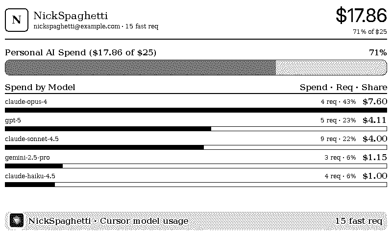
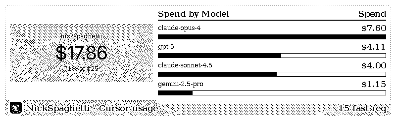
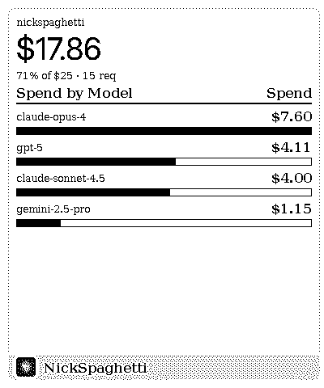
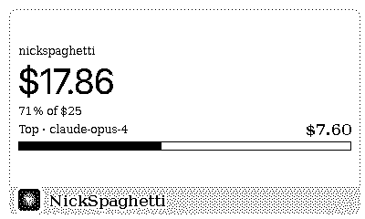

# Cursor Member Usage

A [TRMNL](https://usetrmnl.com) plugin that shows one team member's Cursor AI
spend, their fast-request count, and a per-model breakdown for the current
month.

Install one instance per person you want a dashboard for.

## What it shows

- Personal spend against a configurable soft budget, as a progress meter
- Spend by model, ranked. Each row has dollar spend, request count, and share
  of the member's total
- Fast request total for the member

## Layouts

All four TRMNL layouts render from the same markup. Sample data below, not a
real account.

Smaller layouts drop detail. They are not the full layout shrunk down.

| Layout | Size | Shows |
|--------|------|-------|
| Full | 800x480 | 6 models, request count and share |
| Half horizontal | 800x240 | Stat block, 4 models |
| Half vertical | 400x480 | Stacked stat, 4 models |
| Quadrant | 400x240 | Stat, top model only |

Regenerate all four with `make screenshots` after changing a template.

### Full



### Half horizontal



### Half vertical



### Quadrant



## Works on both TRMNL devices

One set of templates covers both. No separate X markup.

| Device | Panel | Logical viewport | Palette | Size class |
|--------|-------|------------------|---------|------------|
| TRMNL OG | 800x480 | 800x480 | 1-bit, dithered fills | `screen--md` |
| TRMNL X | 1872x1404 | 1040x780 (scale 1.8) | 16-grays, solid fills | `screen--lg` |

## Data source

The team `/teams/spend` endpoint only returns per-member totals. It has no model
breakdown. To get spend per model, this plugin polls the Cursor admin
usage-events endpoint and aggregates client-side in `transform.js`.

- **Endpoint**: `POST https://api.cursor.com/teams/filtered-usage-events`
- **Auth**: HTTP Basic, API key as the username with an empty password. Not a
  bearer token.
- **Window**: calendar month to date, sent as epoch-millisecond `startDate` and
  `endDate`. Both are required by the API.
- **Page size**: 1000, Cursor's documented maximum. If a member exceeds that in
  one month the transform sets `truncated: true` so the shortfall is visible
  rather than silent.

Calendar month is an approximation of your billing period. If your Cursor
billing cycle doesn't start on the 1st, adjust `startDate` in
`src/settings.yml`.

### Scoping to one person

Filtering happens twice, on purpose.

1. **In the request.** `polling_body` sends `"email": "{{ cursor_member_email }}"`, so Cursor returns only that member's events.
2. **In the transform.** Events are re-filtered against the same address before anything is totalled.

The second pass is a backstop. A typo'd `CURSOR_MEMBER_EMAIL` or an ignored
filter would otherwise let team-wide events through and get labelled "Personal
AI Spend". On a mismatch the dashboard shows `$0.00`, which is wrong but
obviously wrong. Showing the whole team's spend as one person's is wrong and
believable.

`foreignEvents` in the transform output counts events that had to be discarded.
It should always be 0. Anything else means the request-level filter didn't hold.

The re-filter is skipped in two cases, so a schema change degrades to "show
everything" rather than "show nothing":

- No member is configured
- The response carries no `userEmail` at all

None of this limits the API key. Filtering is a query parameter, not a
permission boundary. The key reads every member's usage and, on Enterprise
plans, can remove people from the team. Cursor issues no read-only or per-user
scoped key.

### Field mapping

`transform.js` reads these keys off each usage event:

| Field | Used for |
|-------|----------|
| `model` | Grouping key, shown verbatim (see below) |
| `chargedCents` | Spend. What the team was actually billed |
| `tokenUsage.totalCents` | Spend fallback when `chargedCents` is absent. Pre-discount |
| `requestsCosts` | Fast requests. A max-mode event can be worth more than one |
| `isTokenBasedCall` | Token-based calls bill on tokens, so they contribute no fast requests |
| `userEmail` | Display name and email, derived |
| `pagination.hasNextPage` | Truncation flag |

## Configuration

| Field | Description | Required |
|-------|-------------|----------|
| **Cursor Admin API Key** | cursor.com/dashboard → Settings → Cursor Admin API Keys | Yes |
| **Member Email** | The teammate whose usage this instance shows | Yes |
| **Personal Budget ($)** | Soft monthly budget for the spend meter | Yes, defaults to 25 |

## Development

From the repo root:

```bash
cp .env.example .env    # CURSOR_API_KEY, CURSOR_MEMBER_EMAIL
make dev                # http://localhost:4567
```

```bash
make test     # transform unit tests, no API key needed
make lint     # TRMNL best-practice checks
make build    # static HTML into _build/
```

`fixtures/filtered-usage-events.json` is a real-shaped sample response. The
tests run against it. You can also paste it into the plugin's Static Data field
to preview without a live key.

### A note on the auth header

`polling_headers` in `src/settings.yml` looks odd:

```
authorization=Basic%20{{ cursor_api_key | append: ':' | base64_encode | replace: '=', '%3D' }}
```

The `replace` is load-bearing. TRMNL parses that header string by splitting on
`&` then `=`, keeping the first two fields, then URL-decoding the value. Base64
padding is `=`, so without escaping it the credential gets silently truncated
and every request comes back 401. `+` and `/` need no escaping. The decoder
leaves `+` alone.

### One `.layout` per view

The framework hard-sizes `.layout` to the whole screen:

```css
.layout { width: var(--screen-w); height: var(--screen-h) }
.view--full .layout { height: calc(var(--screen-h) - var(--gap)*2) }
```

Those `.view--* .layout` rules match every descendant, not just the direct
child. Nest a second `.layout` and it inflates to 800x480 and pushes the rest of
the view off screen. The symptom is a blank panel with only the title bar
visible.

Each view has exactly one `.layout` as its root. Everything inside groups with
`.flex` plus `flex--row` / `flex--col` / `flex--center-y` / `stretch-x`.

Other classes that do not exist in framework 3.2.0:

| Does not exist | Use instead |
|----------------|-------------|
| `layout--middle` | `flex--center-y` |
| `layout--gap` | `gap--base` |
| `gap--1` / `gap--2` / `gap--4` | `gap--xsmall` / `gap--small` / `gap--base` / `gap--medium` / `gap--large` / `gap--xlarge` |
| `screen--x` | `screen--lg` |

### Model names are shown verbatim

No prettifying. `claude-opus-4` renders as `claude-opus-4`, not "Opus 4".

An earlier version mapped ids to friendly labels with a regex, and it collided:

| Model id | Old label |
|----------|-----------|
| `claude-opus-4` | Opus 4 |
| `claude-opus-4-1-20250805` | Opus 4 |
| `claude-opus-4-5-thinking` | Opus 4 |
| `gemini-2.5-pro` | Gemini 2.5 |
| `gemini-2.5-flash` | Gemini 2.5 |

Three separate rows reading "Opus 4" with three different dollar amounts, and no
way to tell pro from flash despite the price difference. It only shortened some
families too. The `gpt` branch uppercased the whole id, and anything
unrecognized fell through in lowercase.

A lookup table keyed on the full id would be safe if you want friendly names
back. Regex prefix matching on model names is what caused this.

### Nothing is truncated

No element carries `data-clamp`. Names, emails, and model ids always render in
full, wrapping to a second line when they don't fit rather than cutting off
with an ellipsis.

That needs `.cmu-wrap` (`overflow-wrap: anywhere`) on those spans. Emails and
model ids contain no spaces, so without it they overflow the column instead of
wrapping. Add a new field holding an unbroken string and it needs the same
class.

### Dollar formatting

Liquid's `round: 2` renders 140 cents as `1.4`, and Liquid has no sprintf. The
transform emits finished strings (`spend`, `totalSpend`) and the templates print
those directly.
